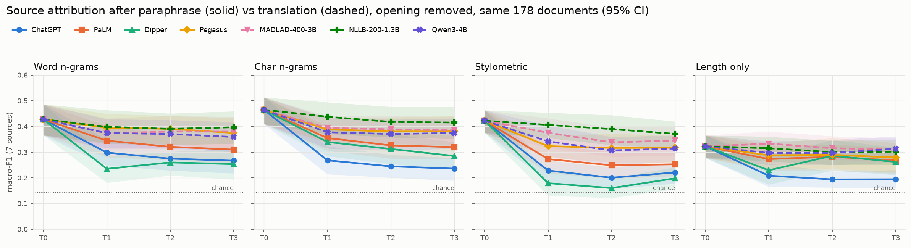
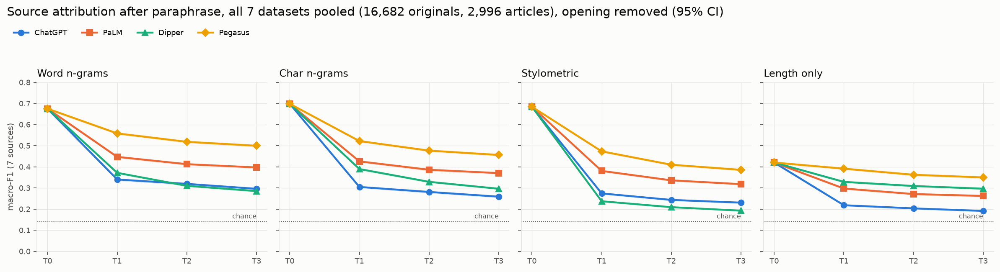
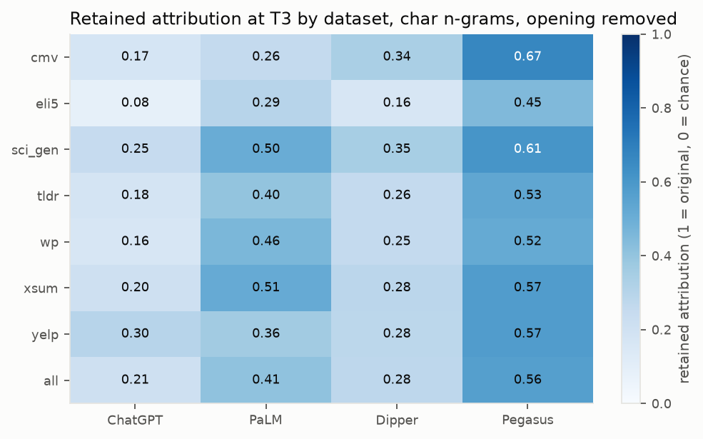
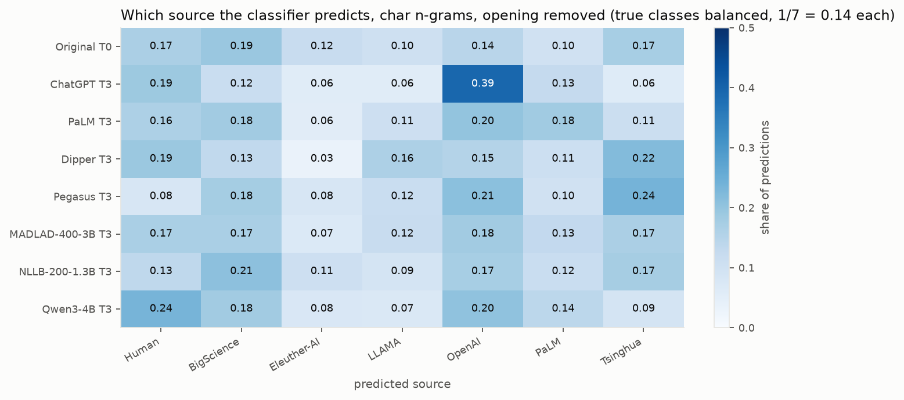

# RQ2: Can the original source of a text still be identified after rewriting?

1. **Question.** Each original text in the Ship of Theseus corpus was written by a human or by one of six LLMs (BigScience, Eleuther-AI, LLAMA, OpenAI, PaLM, Tsinghua). A classifier trained on **original** texts learns to recognise the source. How well does it still recognise it after one, two or three rewrites? And does round-trip translation (English → Spanish → English) behave differently from English paraphrasing?
2. **Short answer.**
   - **Paraphrasing erases more of the source than translation.** It erases much of the source signal, and more of it than round-trip translation does.
   - **Much of what survives paraphrasing is just text length.**
   - **ChatGPT replaces the source's style with its own.** On all 7 datasets, 55% of its rewrites of non-OpenAI texts are attributed to OpenAI.
   - **Most of the loss happens in round 1,** though it keeps growing through T3.

Source: `notebooks/rq2_source_attribution.ipynb`. Protocol: `docs/protocol_rq2.md`. Tables and figures: `results/rq2_attribution/`.

---

## Method

| | |
|---|---|
| Protocol | Samer Ahmed's RQ2 protocol, ported verbatim (`src/pilot/attribution.py`). Our T0 features, folds and all 8,000 T0 predictions are **100% identical** to his, so his translator predictions and our paraphrase predictions come from the same classifiers |
| Classes | 7 sources, chance = 0.143 macro-F1 |
| Training | T0 originals only; the classifiers never see a rewrite |
| Splits | 5 article-grouped folds × 5 shufflings: an article's texts (all sources, rewriters, rounds) are always on one side |
| Models | TF-IDF character 2-5-grams (headline), TF-IDF word 1-2-grams, 187 stylometric features, and a length-only control. All logistic regression with fixed hyperparameters |
| Text variant | **Shared opening removed** (primary): the LLM texts start with the human article's first ~30 words, which are removed from every text |
| Uncertainty | 95% article-cluster bootstrap CIs |

**Retained attribution** = (macro-F1 at Tk − chance) / (macro-F1 at T0 − chance). This is RQ1's 1 → 0 scale: 1 means as identifiable as the original, 0 means chance.

Two scopes:

- **Matched XSum (translation vs paraphrase):** 178 documents and 31 articles that all 3 translators (MADLAD-400-3B, NLLB-200-1.3B, Qwen3-4B) and all 4 paraphrasers completed.
- **Full corpus (paraphrase only):** 16,682 originals, 2,996 articles, 7 datasets. Each dataset has its own classifiers, and the results are pooled. 13M predictions; run on Colab.

---

## 1. Paraphrase vs translation (same 178 XSum documents)

Character n-grams at T3:

| Rewriter | Macro-F1 | Retained | Gain over length-only |
|---|---|---|---|
| *Original (T0)* | *0.47* | *1.00* | *+0.14* |
| NLLB-200-1.3B | 0.42 | 0.85 | +0.11 |
| MADLAD-400-3B | 0.39 | 0.75 | +0.08 |
| Pegasus | 0.38 | 0.74 | +0.10 |
| Qwen3-4B | 0.38 | 0.72 | +0.06 |
| PaLM | 0.32 | 0.55 | +0.05 |
| Dipper | 0.29 | 0.44 | +0.02 |
| ChatGPT | 0.24 | 0.29 | +0.04 |

**Family gap at T3** (all translator predictions pooled minus all paraphraser predictions pooled; paired article bootstrap):

| Model | Translation | Paraphrase | Gap [95% CI] |
|---|---|---|---|
| Char n-grams | 0.39 | 0.31 | **+0.08 [0.04, 0.12]** |
| Stylometric | 0.35 | 0.25 | **+0.09 [0.06, 0.13]** |
| Word n-grams | 0.38 | 0.31 | **+0.08 [0.03, 0.12]** |

- **Translation keeps more of the source on every model.** All three CIs exclude zero.
- **Translators keep 72-85% of the signal; most paraphrasers keep 29-55%.**
- **Pegasus is the exception** (74%), overlapping the translators. It is also the most conservative paraphraser in RQ1.
- **Consistent with RQ1:** translation preserves wording and style more than paraphrase.

## 2. Full corpus: all 7 datasets (paraphrase only)

Pooled, character n-grams, opening removed. CIs are about ±0.006.

| | T0 | T1 | T2 | T3 | Retained at T3 | Gain over length at T3 |
|---|---|---|---|---|---|---|
| Original | 0.70 | | | | 1.00 | +0.28 |
| Pegasus | | 0.52 | 0.48 | 0.46 | 0.56 | +0.11 |
| PaLM | | 0.43 | 0.39 | 0.37 | 0.41 | +0.11 |
| Dipper | | 0.39 | 0.33 | 0.30 | 0.28 | **0.00** |
| ChatGPT | | 0.31 | 0.28 | 0.26 | **0.21** | +0.07 |

Retained attribution at T3 by dataset:

| | cmv | eli5 | sci_gen | tldr | wp | xsum | yelp | all |
|---|---|---|---|---|---|---|---|---|
| ChatGPT | 0.17 | **0.08** | 0.25 | 0.18 | 0.16 | 0.20 | 0.30 | 0.21 |
| PaLM | 0.26 | 0.29 | 0.50 | 0.40 | 0.46 | 0.51 | 0.36 | 0.41 |
| Dipper | 0.34 | 0.16 | 0.35 | 0.26 | 0.25 | 0.28 | 0.28 | 0.28 |
| Pegasus | **0.67** | 0.45 | 0.61 | 0.53 | 0.52 | 0.57 | 0.57 | 0.56 |

- **The XSum ranking holds everywhere.** Pegasus retains the most in every dataset. ChatGPT retains the least in six of seven, and essentially nothing in eli5 (0.08).
- **A stronger classifier shows more of the loss.**
  - With about 2,000 training originals per dataset (instead of about 150), originals become much easier to attribute (0.70 vs 0.47).
  - Paraphrases gain far less, so the *share* of the signal they erase is larger than the small XSum set suggested.
- **The loss continues past round 1.** Round 1 removes most of the signal, but the further decline from T1 to T3 is now clear for every paraphraser. The 31-article set was too small to show it.

## 3. Much of what survives paraphrasing is length

- **Dipper:** the text models are **no better than length alone** at T3 (gain 0.00 for char n-grams; −0.10 for the stylometric model).
- **Matched XSum:** ChatGPT, PaLM and Dipper gain only +0.02 to +0.05 over the length-only model at T3, while translators gain +0.06 to +0.11.
- **Every text cut to 50 words:**

| Rewriter at T3 | Matched XSum | Full corpus |
|---|---|---|
| ChatGPT | 0.15 | 0.16 |
| PaLM | 0.18 | 0.22 |
| Dipper | 0.19 | 0.19 |
| Pegasus | 0.27 | 0.34 |

  Chance is 0.14: only Pegasus keeps a real signal beyond length.

- **Caveat:** truncation does not remove length completely. Some texts are shorter than 50 words, and sentence statistics remain, so length-only still scores 0.30-0.32 at T0.

## 4. ChatGPT replaces the source with its own style

Share of texts attributed to **OpenAI**, counting only texts whose true source is *not* OpenAI (char n-grams, T3):

| | Originals | ChatGPT | PaLM | Dipper | Pegasus |
|---|---|---|---|---|---|
| Matched XSum | 3% | **34%** | 13% | 9% | 11% |
| Full corpus | 4% | **55%** | 18% | 6% | 5% |

- **Every dataset shows it:** from 33% (yelp) to 74% (eli5) of ChatGPT rewrites are attributed to OpenAI.
- **What this means:** the classifier is not just losing the source; it increasingly detects the rewriter. ChatGPT's low attribution score is largely a **systematic relabelling** toward its own family, not random noise. This matches RQ3, where paraphrasers stamp their own style.
- **No PaLM analogue:** PaLM rewrites are attributed to PaLM 16% of the time (originals 5%), but Dipper rewrites even more often (19%). So there is no PaLM-specific takeover; the weaker pattern seen on the 31-article set did not generalise.

This heatmap covers the matched XSum set and counts every true source, OpenAI included. On that basis 39% of ChatGPT's T3 rewrites are predicted as OpenAI, against 14% of the originals.

## 5. The shared opening is not the signal

Removing the ~30-word shared opening leaves T0 scores the same or higher (char n-grams 0.42 → 0.47 on matched XSum). The opening is identical across sources, so it carries content, not the source signal. This reproduces Samer's finding.

---

## Caveats

- **The translation comparison is small:** XSum only, 31 articles, CIs about ±0.05 per rewriter. Only the family gap and large differences are reliable. Translations exist only for these 200 documents, so the full-corpus analysis is paraphrase-only.
- **Length control is one-sided:** text-dependent controls (the 50-word truncation) exist only for paraphrases, because Samer's translated texts are not in the repo.
- **Classical models only:** fixed, untuned classical models measure the relative survival of the signal, not the best achievable attribution.
- **Takeover is measurable for few rewriters:** six of the seven sources are LLM outputs, so it can only be tested for rewriters with a matching source class (ChatGPT, and PaLM, which shows none).
- **Different vocabularies by scope:** the full corpus uses the team standard's held-out function-word list; the matched set uses Samer's XSum list, so as to reproduce his classifiers exactly.

## Files

| File | Content |
|---|---|
| `results/rq2_attribution/scores.csv` | Matched XSum: macro-F1 / accuracy with CIs, every model × variant × rewriter × round, with retained attribution |
| `results/rq2_attribution/family_gap_T3.csv`, `retained_T3.csv`, `gain_over_length_T3.csv` | Section 1 tables |
| `results/rq2_attribution/length_control_truncated.csv`, `rewriter_takeover.csv`, `prediction_distribution_T3.*` | Sections 3-4 (matched XSum) |
| `results/rq2_attribution/full_scores.csv` | Full corpus: every dataset (and "all") × model × variant × rewriter × round, with retained attribution and gain over length |
| `results/rq2_attribution/full_rewriter_takeover.csv`, `full_retained_by_dataset.*`, `full_attribution_curves.png` | Full-corpus figures and tables |
| `results/rq2_attribution/port_agreement_T0.csv` | Check that our classifiers reproduce Samer's predictions exactly |
