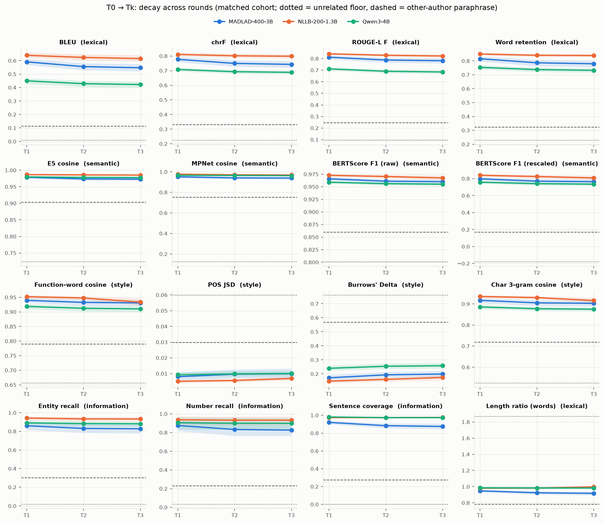
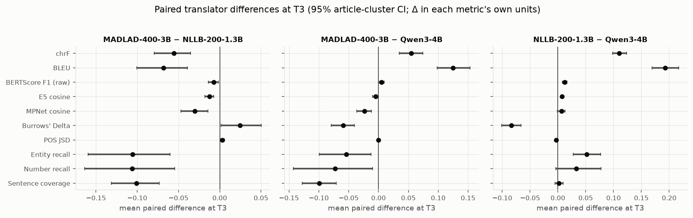
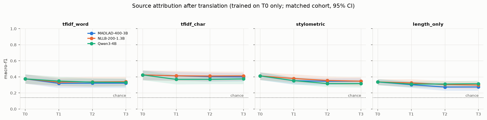
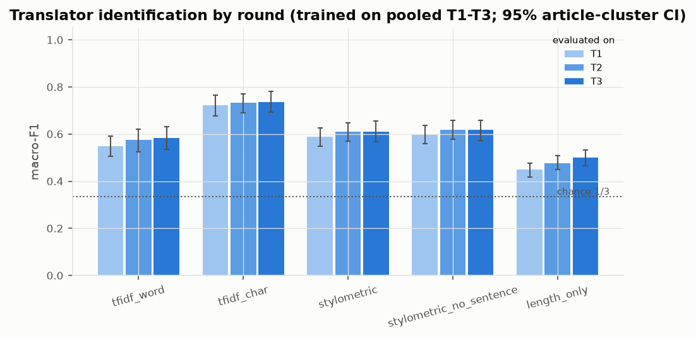
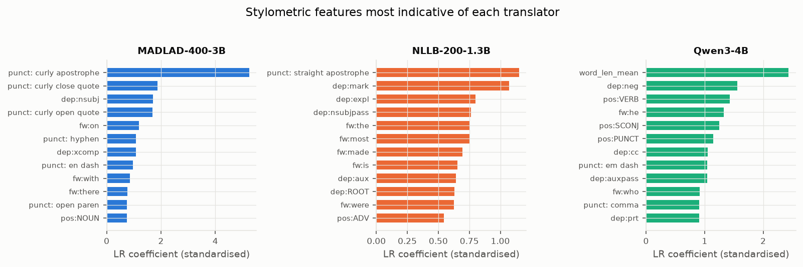

# Multilingual Ship of Theseus: research summary (MADLAD · NLLB · Qwen)

The same 200 XSum T0 documents (31 original articles × 7 source labels: Human + 6 LLM generators) were each sent
through three English→Spanish→English round trips, T0 → S1 → T1 → S2 → T2 → S3 → T3. Each translator ran on its
own. Details, CIs and code are in the three executed notebooks; table descriptions are in [README.md](README.md).

## Data coverage
| Translator | Documents | Complete T0-T3 chains | Incomplete (genuine attrition) |
|---|---|---|---|
| MADLAD-400-3B (`google/madlad400-3b-mt`) | 200 | 196 | 4: 3 legacy round-1 token-cap failures, 1 token-cap loop at T2 |
| NLLB-200-1.3B (`facebook/nllb-200-distilled-1.3B`) | 200 | 197 | 3: repetition at T1, T2 and T3 |
| Qwen3-4B (`Qwen/Qwen3-4B-Instruct-2507`) | 200 | 200 | 0 |

- **Matched cohort:** 193 documents, complete for every translator. All 31 articles and all 7 sources are present.
  Primary comparisons use this cohort; all-available results are saved alongside.
- **Invalid outputs:** these are kept, never repaired, and never fed into a later round.
- **Lineage:** verified for all 3,570 valid generated records.

## RQ1: How do texts decay under repeated round trips?

- **First round dominates:** 84-94% of the total T0→T3 loss happens in round 1. By T3, about half of the MADLAD
  (50%) and NLLB (53%) chains are exact fixed points (T3 = T2). Qwen has 15%.
- **Lexical vs semantic:**
  - Qwen paraphrases most (BLEU 0.42 at T3, vs 0.55 MADLAD and 0.62 NLLB).
  - Meaning stays high for all three: BERTScore F1 0.955-0.968 and MPNet 0.94-0.97, versus 0.86 and 0.75 for
    the same article written by another author.
- **Style:** Qwen drifts most (Burrows' Delta 0.26 vs 0.17-0.20). POS distributions are almost unchanged for all
  three translators.
- **Information (heuristic):**
  - NLLB preserves entities best (0.93); MADLAD worst (0.83).
  - MADLAD merges sentences (-15% sentence count by T3) and has the lowest sentence coverage (0.875).
  - Rare genuine failures exist: a MADLAD hallucinated replacement, an NLLB inserted sentence.

## RQ2: Is the original source still identifiable after translation?

- **Setup:** train on original T0 texts only, and test on held-out articles. Folds are grouped by article.
  There are 7 classes, so chance is 0.14.
- **On originals:** the best model (character n-grams) reaches macro-F1 0.43, and a length-only control reaches
  0.34.
- **After translation:** the signal survives with little loss, at 0.40-0.41 for MADLAD and NLLB and 0.37-0.38 for
  Qwen at T1-T3. Almost all of the drop is in round 1.
- **Shared opening:** removing the ~30-word human opening shared across sources does **not** reduce attribution
  (T0: 0.47 without it), so it is not the cue the classifier uses.

## RQ3: Do translators leave a fingerprint?

- **Setup:** 3 balanced classes, so chance is 0.33; 1,737 texts; grouped by article.
- **Main result:** character n-grams identify the translator at macro-F1 0.73. The score is stable from T1 to T3
  (0.72 → 0.74) and transfers across rounds.
- **Typography:** MADLAD adds curly quotes and apostrophes to 58% of its texts and NLLB to none. Normalising
  typography lowers the character model to 0.67, still far above chance.
- **Controls:**
  - a length-only control reaches 0.48;
  - removing sentence-boundary features does not hurt (0.61 vs 0.60);
  - leave-one-source-out keeps 0.55-0.79.

## Caveats
- **Sample size:** only 31 articles, so CIs are wide.
- **Segmentation confound:** MT systems translate sentences while Qwen translates whole documents.
- **Information flags:** these are heuristic warnings, not validated factual errors.
- **Scope:** one language pair and one decoding setting per model.
- **Fourth translator:** Phi-4-mini is not included yet. It will be added automatically when its finalized dataset
  exists.
