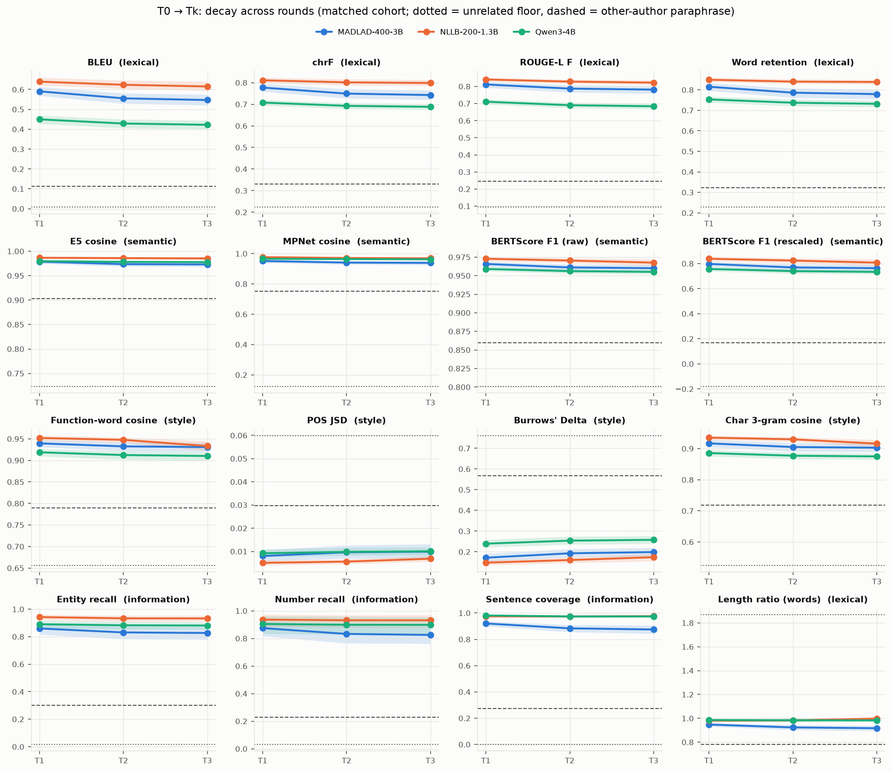
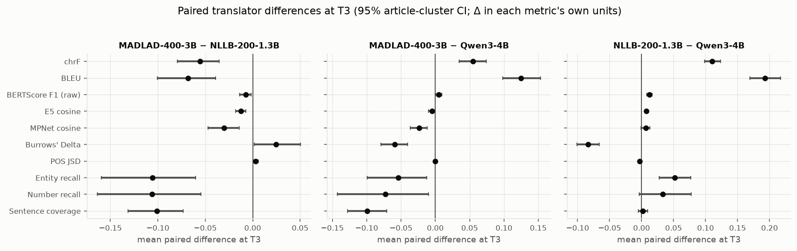
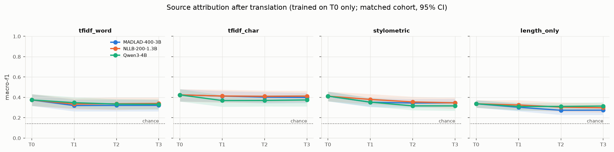
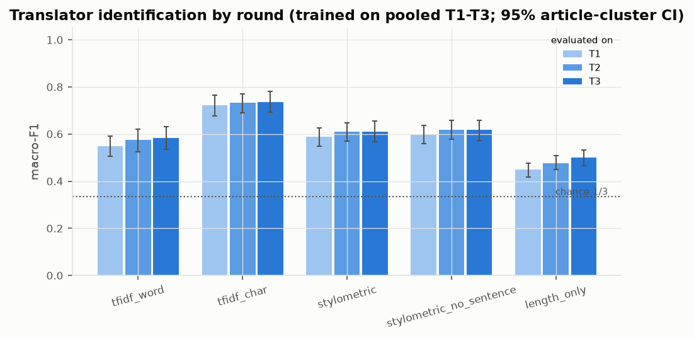
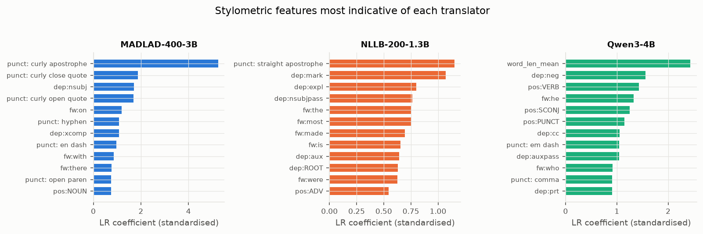

# Summary of findings: round-trip translation of XSum texts (MADLAD · NLLB · Qwen)

*Samer Ahmed. Notebooks: [RQ1](notebooks/01_RQ1_Translation_Decay.ipynb) · [RQ2](notebooks/02_RQ2_Source_Attribution.ipynb) · [RQ3](notebooks/03_RQ3_Translator_Fingerprint.ipynb). Tables: [results/](results/).*

## Setup
- **Data:** **XSum only**, 200 original English documents (T0) from **31 original articles**. They carry **seven
  source labels**: Human (the XSum article) and six LLM sources (BigScience, Eleuther-AI, LLAMA, OpenAI, PaLM,
  Tsinghua).
- **Translators:** **three**, each run independently through three English→Spanish→English round trips
  (T0 → S1 → T1 → S2 → T2 → S3 → T3):
  - **MADLAD-400-3B** (`google/madlad400-3b-mt`);
  - **NLLB-200-1.3B** (`facebook/nllb-200-distilled-1.3B`);
  - **Qwen3-4B** (`Qwen/Qwen3-4B-Instruct-2507`).

  **Phi-4-mini has not yet been included.**
- **Matched cohort:** **193 documents from all 31 articles**, complete for every translator. It is used for all
  cross-translator comparisons.
- **Attrition:** genuine and kept, never repaired:

  | Translator | Complete chains | Lost chains |
  |---|---|---|
  | MADLAD | 196 | 3 round-1 token-cap failures, 1 token-cap loop at T2 |
  | NLLB | 197 | 3 repetition failures |
  | Qwen | 200 | 0 |

- **Statistics:** confidence intervals are 95% article-cluster bootstraps. Classifiers use **article-grouped splits**:
  5 folds × 5 shufflings, where all texts of an article stay on one side.

## RQ1: How do texts decay over repeated round trips?

- **The first round trip does almost all the damage:** 84-94% of the total T0→T3 loss (chrF, BERTScore) is already
  present at T1.
- **Chains then converge:** by T3, about half of the chains are exact fixed points (T3 identical to T2): 50% for
  MADLAD, 53% for NLLB, 15% for Qwen.
- **Lexical and semantic decay differ:**
  - Qwen paraphrases most (BLEU at T3: Qwen 0.42, MADLAD 0.55, NLLB 0.62).
  - All three keep meaning far above an independent rewrite: BERTScore F1 0.955-0.968 and MPNet 0.94-0.97, versus
    0.86 and 0.75 for the same article written by another author.
- **Style:** Qwen drifts most (Burrows' Delta 0.26 vs 0.17-0.20). POS distributions barely change for any
  translator.
- **Information preservation (heuristic warnings):**
  - NLLB keeps entities best (recall 0.93) and MADLAD worst (0.83).
  - MADLAD merges sentences (-15% sentence count by T3) and has the lowest sentence coverage (0.875).
  - A few genuine failures occur: one MADLAD round trip replaced an article with unrelated text, and NLLB inserted
    an unrelated sentence once.
  - Many "lost" entities are normalisations (e.g. "UK" / "Britain"), so the flags overstate real loss.

## RQ2: Is the original source still identifiable after translation?

- **Setup:** classifiers are trained on original T0 texts of training articles only. They are evaluated on
  held-out articles' T0 and on each translator's T1/T2/T3. There are 7 classes, so chance is 0.14.
- **On originals:** the best model (character 2-5-gram TF-IDF) reaches macro-F1 0.43 [0.36, 0.48]. A length-only
  control reaches 0.34, so length explains much of the signal.
- **After translation:** the source signal barely erodes. At T3, macro-F1 is 0.40 (MADLAD), 0.41 (NLLB) and 0.38
  (Qwen). Almost all of the change happens in round 1, and translator differences lie within the CIs.
- **Shared-opening ablation:** removing the ~30-word human opening that all sources share does **not** reduce
  attribution (T0: 0.47), so the classifier does not rely on it.

## RQ3: Do translators leave a fingerprint?

- **Setup:** 3 balanced classes, so chance is 1/3. The data are 1,737 translated texts from the matched cohort,
  with article-grouped splits.
- **Main result:** character n-grams identify the translator at **macro-F1 0.73**. The score is stable from T1 to T3
  (0.72 → 0.74), and a model trained on T1 scores 0.74 on T3.
- **Typography:** part of the fingerprint is typographic. MADLAD adds curly quotes and apostrophes to 58% of its
  texts, Qwen to about 15%, NLLB to none. Normalising typography lowers the character model to 0.67, still far above
  chance.
- **Controls:**
  - length only reaches 0.48;
  - removing sentence-boundary features does not hurt (0.61 vs 0.60);
  - leave-one-source-out keeps 0.55-0.79.

## Limitations
- **Sample size:** 31 articles only, so confidence intervals are wide. Translator differences in RQ2 are not
  individually significant.
- **Segmentation confound:** MADLAD and NLLB translate sentence by sentence while Qwen translates whole documents.
  This partly drives the sentence-level metrics. It is controlled for in RQ3.
- **Information flags:** entity, number and sentence-omission flags are heuristic warnings, not validated factual
  errors.
- **Cohort bias:** the matched cohort excludes 7 documents with failed stages. Failures are not random, so it
  slightly favours easier documents.
- **Scope:** one dataset (XSum), one language pair (English↔Spanish), greedy decoding, and fixed, untuned
  classifiers. The English-paraphrasing baseline is not part of this corpus.
